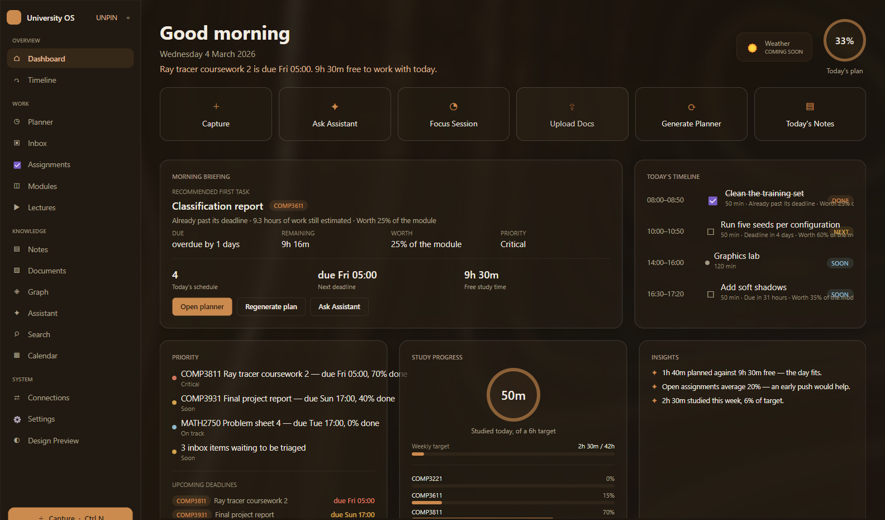
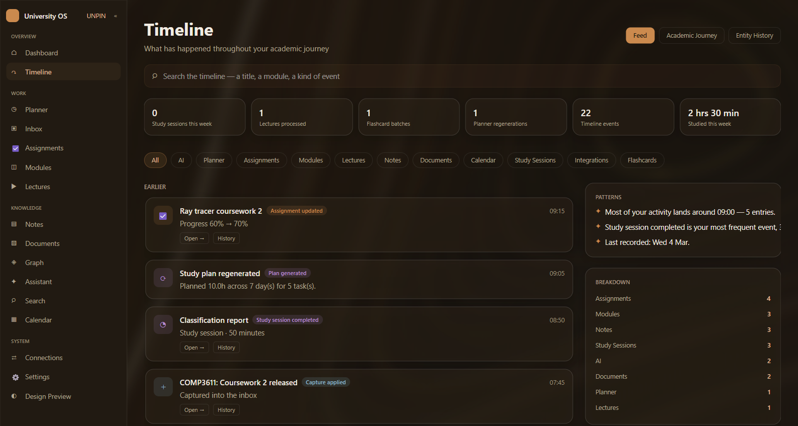

# University OS

A native Windows desktop app for university life. It brings modules, assignments, lectures, notes, documents, emails, calendars and repositories into one connected, offline-first workspace, and answers one question each morning:

> **"What should I be doing right now?"**



*Screenshots use made-up sample data.*

## Features

- **Study planner** that schedules work around deadlines, priorities and available time
- **Dashboard and timeline** showing what needs attention today
- **Inbox and quick capture** for text, files and deadlines
- **Notes, documents and full-text search** across everything stored
- **Connections** to Moodle, GitLab, Gmail, Outlook, Google Drive and OneDrive
- **Optional AI assistant** using Claude through a provider-agnostic interface. Everything else works offline without it
- **Light and dark themes**, with automated readability checks



## Built with

F#, .NET 10, Avalonia with Avalonia.FuncUI (Elmish MVU), SkiaSharp and SQLite with FTS5.

It's a true native app, not a web page in a window: no part of the interface uses HTML, CSS or JavaScript.

## Status

The backend is feature-complete. The interface is moving to a new design one screen at a time. Dashboard, Timeline, Planner and Inbox are finished, and the other screens still use the original design.

## Testing

The project has over 2,000 automated tests, including visual regression checks against saved reference images. Mutation testing was also used to check that the tests catch real faults.

## Run it

You need Windows 10 or 11 (x64) and .NET SDK 10.0.3xx.

```powershell
dotnet restore UniversityOS.slnx
dotnet build   UniversityOS.slnx
dotnet test    UniversityOS.slnx
.\run.cmd
```

`.\publish.cmd` creates a self-contained build at `publish\UniversityOS\UniversityOS.exe`.

## Project layout

```
src/
  UniversityOS.Domain/          pure types and the planner algorithm, no dependencies
  UniversityOS.Application/     interfaces and use-case services
  UniversityOS.Infrastructure/  SQLite, file store, secrets, AI provider, connectors
  UniversityOS.App/             Avalonia shell, feature views and rendering
tests/
  UniversityOS.Tests/           automated tests and reference images
docs/
  ARCHITECTURE.md               how the layers fit together
  PRESENTATION-ARCHITECTURE.md  rendering, themes and visual testing
```

## Your data

Data is stored in `%APPDATA%\UniversityOS\`, never in this repository. API keys are encrypted with Windows DPAPI. See [DATA_MIGRATION.md](DATA_MIGRATION.md) for backup and restore.

## Licence

No licence has been granted, so all rights are reserved.
